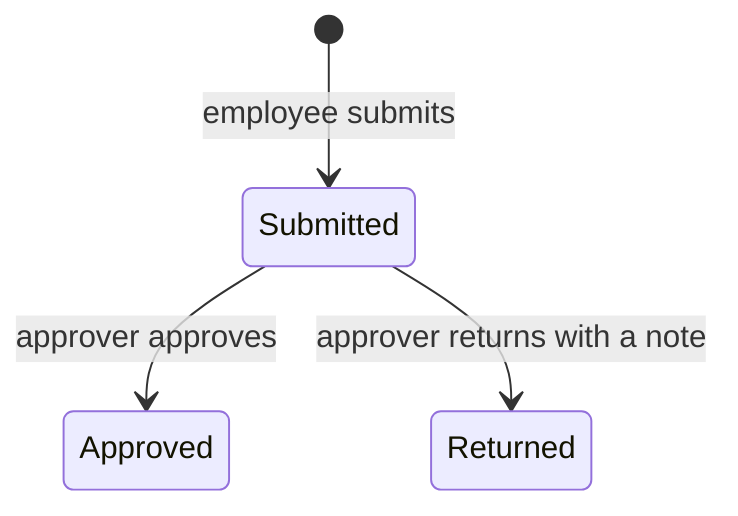

## What it solves

Employees no longer send receipts by email. Each expense is one claim with an amount, a date and a
category, and its status is visible to the employee at all times.

## Business rules

- A new claim is **Submitted** immediately; there is no saved draft in the demo.
- Amounts are whole yen without separators. `12,000` is rejected; `12000` is accepted.
- An employee sees only their own claims.
- A returned claim shows the approver's note on its detail page.

## Status

